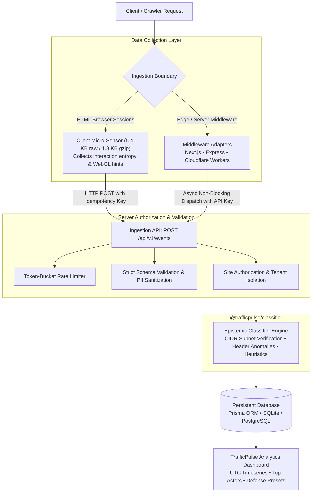

# TrafficPulse ⚡

<p align="center">
  <strong>Evidence-based, privacy-conscious web traffic observability and classification for the agentic web.</strong>
</p>

<p align="center">
  <a href="https://github.com/amalrn98/TrafficPulse/blob/main/LICENSE"></a>
  <a href="https://nodejs.org/"></a>
  <a href="https://nextjs.org/"></a>
  <a href="https://www.prisma.io/"></a>
  <a href="https://github.com/amalrn98/TrafficPulse/actions/workflows/ci.yml"></a>
</p>

---

## 🎯 What TrafficPulse Does (and What It Does Not Claim)

**TrafficPulse** is an open-source analytics and observability platform designed to analyze web traffic across human browsers, traditional scrapers, search engine bots, and AI-associated crawlers.

### Distinct Levels of Evidence
TrafficPulse separates evidence levels to avoid misleading conflations:
1. **Declared Identity**: A client transmits a User-Agent claiming to be a crawler (e.g., `GPTBot`). Anyone can forge a header.
2. **Signature Match**: The User-Agent matches recognized regex signatures for known crawler infrastructure.
3. **Network Verification**: The client IP falls within published, official IP/CIDR ranges published by the claiming organization (e.g., OpenAI, Anthropic, Google, Microsoft, Perplexity).
4. **Behavioral Telemetry**: Client-side interaction entropy (mouse directional jitter, scroll deltas, session dwell time) collected via non-invasive client sensors.
5. **Downstream Content Use (Unobservable)**: *TrafficPulse does NOT and CANNOT prove whether retrieved content was stored, indexed, retained for foundation model pre-training weights, or discarded.* Identifying an AI-associated crawler demonstrates network retrieval by that entity's infrastructure, not the downstream computational use.

### Epistemic Guarantees
- **No Simulated Data Contamination**: Production mode never generates artificial analytics. Demo sandbox data is strictly flagged (`isDemo: true`) and isolated at the database level.
- **Server Authority**: The ingestion server authoritatively classifies incoming events. Client-submitted classification claims (such as `trafficCategory: "human"` or `verifiedOrigin: true`) are untrusted and completely ignored.
- **Heuristic Confidence**: Confidence values are documented as heuristic scores (0.0 to 1.0) reflecting available evidence, never fabricated as statistically calibrated probabilities.
- **Unknown Ambiguity**: Requests lacking recognized patterns or displaying conflicting signals are labeled as `unknown` rather than forced into a speculative category.
- **Privacy Minimization**: The tracker sensor records interaction counts and Shannon entropy. It **never** collects raw keystrokes, character inputs, or form field values.

---

## 🏗️ Architecture & Data Flow



---

## 📊 Classification Taxonomy

| Concept | Enum Values / Schema | Description |
| :--- | :--- | :--- |
| **Actor Type** | `human_browser`<br/>`ai_crawler`<br/>`ai_agent`<br/>`search_crawler`<br/>`automation_tool`<br/>`unknown` | Inferred category of entity driving the HTTP request. |
| **Verification** | `verified`<br/>`claimed`<br/>`inferred`<br/>`unverified`<br/>`unknown` | `verified`: Matched published CIDR block.<br/>`claimed`: Declared signature without network verification.<br/>`inferred`: Corroborated via browser sensors/headers.<br/>`unverified`: Declared signature failed published CIDR check. |
| **Activity Type** | `page_view`<br/>`content_fetch`<br/>`api_query`<br/>`unknown` | Observed request interaction mode. |
| **Confidence** | `0.00` to `1.00` (heuristic) | Signal confidence based on evidence corroboration. |

---

## 🚀 Integration Guides

### Option 1: Drop-in Browser Sensor
Paste into your `<head>` tag. Tested bundle size: **5.4 KB uncompressed, ~1.8 KB gzipped**.

```html
<script defer 
  src="https://your-trafficpulse-instance.com/trafficpulse.js" 
  data-site-id="YOUR_SITE_ID"
  data-respect-dnt="true"
></script>
```

#### Sensor Features & Privacy Controls
- **Do Not Track (DNT) & GPC**: Enabled by default (`data-respect-dnt="true"`). Respects `navigator.doNotTrack` and `navigator.globalPrivacyControl`.
- **Explicit Opt-out**: `window.TrafficPulse.optOut()` sets localStorage flag and terminates tracking.
- **Behavioral Signal Opt-In**: Add `data-enable-behavior="true"` to enable mouse entropy, scroll entropy, and WebGL renderer collection. Behavioral signals are disabled by default and require opt-in due to GDPR/ePrivacy considerations.
- **Legacy Alias**: `data-disable-biometrics="false"` is equivalent to `data-enable-behavior="true"` for backward compatibility. The `disableBiometrics` option is deprecated.
- **Deduplication**: Generates an idempotency key (`tp_<timestamp>_<random>`) per page view. Prevents double-counting when `visibilitychange` and `pagehide` both fire.

### Option 2: Next.js Edge Middleware
Captures non-JavaScript scrapers and crawlers before rendering:

```typescript
// middleware.ts
import { withTrafficPulse } from '@trafficpulse/middleware';

export default withTrafficPulse({
  siteId: process.env.TRAFFICPULSE_SITE_ID!,
  apiKey: process.env.TRAFFICPULSE_API_KEY!,
  apiHost: 'https://analytics.yourcompany.com',
  onClassified: (req, classification) => {
    // Optional defense hook: use actorType from the documented taxonomy
    if (classification.actorType === 'automation_tool') {
      return new Response('Access Denied', { status: 403 });
    }
  },
});

export const config = {
  matcher: ['/((?!_next/static|_next/image|favicon.ico).*)'],
};
```

### Option 3: Express.js
```javascript
const express = require('express');
const { createTrafficPulseMiddleware } = require('@trafficpulse/middleware');

const app = express();

app.use(createTrafficPulseMiddleware({
  siteId: process.env.TRAFFICPULSE_SITE_ID,
  apiKey: process.env.TRAFFICPULSE_API_KEY,
  apiHost: 'http://localhost:3000',
}));
```

### Option 4: Cloudflare Workers
```typescript
import { trafficPulseWorker } from '@trafficpulse/middleware';

export default {
  fetch: trafficPulseWorker(async (request, env, ctx) => {
    return new Response('OK');
  }, {
    siteId: 'YOUR_SITE_ID',
    apiKey: 'YOUR_API_KEY',
    apiHost: 'https://analytics.yourcompany.com',
  }),
};
```

---

## 🔒 Security & Data Integrity Controls

- **Database-Level Tenant Isolation**: Events and aggregations are scoped by `siteId`. Cross-site leaks are blocked by indexed database queries.
- **Strict Payload Validation**: Payloads exceeding 64KB receive `413 Payload Too Large`. Timestamps outside `[-7 days, +24 hours]` and malformed structures receive `400 Bad Request`.
- **Idempotent Ingestion**: Duplicate event submissions carrying the same `idempotencyKey` return `200 OK` (`isDuplicate: true`) without inflating totals.
- **Rate Limiting**: Sliding token-bucket rate limiter per site and client IP (120 token burst, 30 req/sec refill). Exceeded clients receive `429 Too Many Requests` with `Retry-After`.
- **Sanitized Error Responses**: Internal exception details, stack traces, and database connection strings are never leaked in API error responses.
- **Privacy IP Masking**: Stored IPs have their host identifiers masked (e.g., `192.168.1.0` or `2001:db8:1:2::`) prior to persistence.
- **Readiness Probe**: Health endpoint at `GET /api/health` validates database connectivity without exposing infrastructure internals.

---

## Classifier Regression Suite

We maintain a regression test harness (`packages/classifier/tests/evaluation.test.ts`) with 19 labelled fixtures covering verified crawlers, real-time AI agents, browsers, spoofed headers, and adversarial inputs.

**Important: This is a regression suite, not an accuracy benchmark.**

The 19 fixtures were designed alongside the classifier to document intended behavior for known traffic patterns. They are not a held-out test set and do not represent real-world traffic distribution. Presenting a 19-sample suite as a precision/recall benchmark would be misleading.

See [docs/EVALUATION.md](docs/EVALUATION.md) for the documented evaluation methodology, fixture provenance, and the limitations of heuristic classifiers.

Latest regression results (`npm test --workspace=@trafficpulse/classifier`):

```
Regression Suite v1.0 (N=19 known-behavior fixtures)
All 19 fixtures pass classification and verification status checks.
This confirms no regressions against documented behavior.
For real-world accuracy, deploy and measure against actual production traffic.
```

Note on evaluation methodology: an independent evaluation against real production traffic samples, including distribution shifts and novel evasion techniques, is required before making any accuracy claims. See docs/EVALUATION.md.

---

## 🛠️ Development & Testing Commands

### Setup & Migrations
```bash
# 1. Install dependencies across workspaces
npm install

# 2. Setup SQLite database schema and generate Prisma client
npm run db:generate --workspace=@trafficpulse/dashboard
npm run db:push --workspace=@trafficpulse/dashboard

# 3. (Optional) Seed isolated demo sandbox dataset
npm run db:seed --workspace=@trafficpulse/dashboard
```

### Running Tests
```bash
# Run all test suites across all workspaces (33 tests total)
npm test

# Run classifier unit & evaluation tests
npm run test --workspace=@trafficpulse/classifier

# Run dashboard persistence, validation & rate limiting tests
npm run test --workspace=@trafficpulse/dashboard

# Run tracker sensor tests
npm run test --workspace=@trafficpulse/tracker

# Run middleware adapter tests
npm run test --workspace=@trafficpulse/middleware
```

### Production Build
```bash
# Compile TypeScript packages and Next.js dashboard
npm run build
```

---

## 📄 License & Attribution

TrafficPulse is licensed under the **[Apache License, Version 2.0](LICENSE)**.
Created and maintained by **[Amal Nair](https://github.com/mythicavalon)**.
