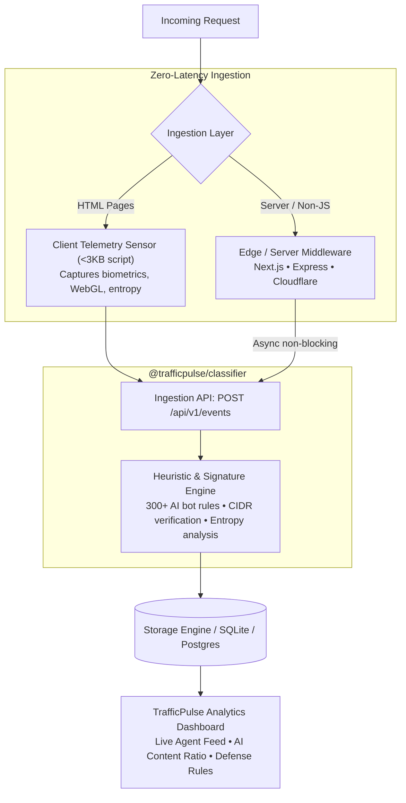

# TrafficPulse ⚡

<p align="center">
  <strong>Production-grade, privacy-preserving web traffic analytics for the Agentic Era.</strong>
</p>

<p align="center">
  <a href="https://github.com/mythicavalon/TrafficPulse/blob/main/LICENSE"></a>
  <a href="https://nodejs.org/"></a>
  <a href="https://nextjs.org/"></a>
  <a href="https://www.docker.com/"></a>
  <a href="https://github.com/mythicavalon/TrafficPulse/actions"></a>
</p>

---

## 🎯 The Agentic Era Blind Spot

In 2026, **over 50% of web traffic is non-human**. Traditional web analytics tools (Google Analytics, Mixpanel, Plausible) lump this into opaque "Direct" traffic or fail to capture it entirely because headless crawlers don't execute client-side JavaScript. Meanwhile, traditional WAFs (Cloudflare, DataDome) only offer binary blocking rather than **intelligent observability**.

**TrafficPulse** bridges this gap: an open-source, production-ready platform that classifies every request across:
1. **Foundation Model Pre-trainers** (`GPTBot`, `ClaudeBot`, `CCBot`, `Bytespider`, etc.) harvesting data for model weights.
2. **Real-time AI Inference / RAG Agents** (`PerplexityBot`, `ChatGPT-User`, `Applebot-Extended`) fetching live web context for user prompts.
3. **Autonomous Agent Swarms** (`AutoGPT`, `browser-use`, `LangChain`, `CrewAI`, `MultiOn`) navigating headless browsers.
4. **Search Engine Indexers** (`Googlebot`, `Bingbot`, `DuckDuckBot`, `YandexBot`).
5. **Organic Human Visitors** verified via biometric interaction entropy and browser signatures.

---

## 🏗️ Architecture



---

## 🚀 2-Click Quickstart Integration

### Option 1: Drop-in HTML Tag (Zero Backend Changes)
Embed this snippet into your HTML `<head>` on any website (WordPress, Webflow, React, static HTML):

```html
<script defer 
  src="https://your-trafficpulse-instance.com/trafficpulse.js" 
  data-site-id="YOUR_SITE_ID"
></script>
```

### Option 2: Next.js Edge Middleware (Zero Latency)
Captures non-JS scrapers, cURL requests, and bots before your page renders:

```bash
npm install @trafficpulse/middleware @trafficpulse/classifier
```

```typescript
// middleware.ts
import { withTrafficPulse } from '@trafficpulse/middleware';

export default withTrafficPulse({
  siteId: process.env.TRAFFICPULSE_SITE_ID!,
  apiHost: process.env.TRAFFICPULSE_HOST!, // e.g., 'https://analytics.yourdomain.com'
});

export const config = {
  matcher: ['/((?!_next/static|_next/image|favicon.ico).*)'],
};
```

### Option 3: Express.js / Node.js
```javascript
const express = require('express');
const { createTrafficPulseMiddleware } = require('@trafficpulse/middleware');

const app = express();

app.use(createTrafficPulseMiddleware({
  siteId: 'YOUR_SITE_ID',
  apiHost: 'http://localhost:3000',
}));
```

### Option 4: Cloudflare Workers
```typescript
import { trafficPulseWorker } from '@trafficpulse/middleware';

export default {
  fetch: trafficPulseWorker(async (request, env, ctx) => {
    return new Response('Hello World');
  }, {
    siteId: 'YOUR_SITE_ID',
    apiHost: 'https://analytics.yourdomain.com',
  }),
};
```

---

## 📊 Traffic Classification Taxonomy

| Category | Identifier | Primary Intent | Signatures & Examples |
| :--- | :--- | :--- | :--- |
| **Organic Human** | `human` | User browsing | Real desktop/mobile browsers with high mouse/scroll entropy |
| **LLM Training Crawler** | `llm_training` | Pre-training datasets | `GPTBot`, `ClaudeBot`, `CCBot`, `Bytespider`, `Google-Extended`, `Meta-ExternalAgent` |
| **AI Inference / RAG** | `ai_agent` | Real-time citation & synthesis | `PerplexityBot`, `ChatGPT-User`, `OAI-SearchBot`, `Applebot-Extended`, Autonomous Agent Swarms |
| **Search Engine Bot** | `search_engine` | SEO indexing | `Googlebot`, `Bingbot`, `YandexBot`, `Baiduspider`, `DuckDuckBot` |
| **Automated Scraper** | `generic_bot` | Scraping / Probing | Puppeteer, Playwright, HeadlessChrome, cURL, Python-requests, Scrapy |

---

## 🐳 Self-Hosting with Docker

You can spin up TrafficPulse in one command:

```bash
# Clone the repository
git clone https://github.com/mythicavalon/TrafficPulse.git
cd TrafficPulse

# Start with Docker Compose
docker compose up -d
```

Open `http://localhost:3000` to access the dashboard.

---

## 🛠️ Monorepo Structure

```
TrafficPulse/
├── apps/
│   └── dashboard/              # Next.js 14 Analytics Dashboard & Ingestion API
│       ├── src/app/            # App Router pages & API routes (/api/v1/events)
│       ├── src/lib/db.ts       # Resilient storage layer with automatic seed demo
│       └── public/             # Serves trafficpulse.js directly for 1-click integration
├── packages/
│   ├── classifier/             # Core classification engine & 300+ bot signatures
│   ├── tracker/                # Ultra-lightweight (<3KB) client behavioral sensor
│   └── middleware/             # Drop-in Next.js, Express, and Cloudflare adapters
├── docker-compose.yml          # 1-click deployment configuration
├── Dockerfile                  # Multi-stage production container
└── LICENSE                     # Apache 2.0 License
```

---

## 🧪 Development & Testing

```bash
# 1. Install dependencies across workspaces
npm install

# 2. Run unit tests on classification engine
npm run test --workspace=@trafficpulse/classifier

# 3. Start local development server
npm run dev
```

---

## 🛡️ Actionable Defense Rules

TrafficPulse includes built-in generators for:
- **`robots.txt`**: Selectively allow real-time RAG retrieval engines (to maintain AI search citations) while disallowing bulk foundation model harvesters.
- **Cloudflare WAF Expressions**: Ready-to-copy firewall filters targeting verified scraper ASNs and datacenter IP blocks.

---

## 📄 License & Attribution

TrafficPulse is open-source software licensed under the **[Apache License, Version 2.0](LICENSE)**.

**Created & Maintained by [Amal Nair](https://github.com/mythicavalon)**. Contributions, feature requests, and PRs are welcome!
